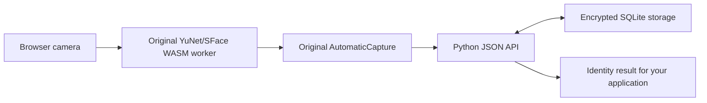

# Python + SQLite integration guide

## Runtime and processing



The plain JavaScript UI imports `AutomaticCapture` from the original module graph.
It keeps the five observations, 350 ms spacing, guide/quality/continuity checks,
camera mirroring, worker recovery and actual model weights. Python ports the
original medoid/MAD aggregation, unit-vector validation, cosine score clamping,
duplicate checks and unanimous unique identity rule. PHP/MySQL/Angular are absent
from this runtime. Nothing writes CCC attendance or calls its login/session APIs.

`standalone/service.py` contains the business-neutral operations;
`SQLiteRepository` owns encrypted storage and transactions. Applications can call
the JSON API, import the service in Python, or consume the client event. Collection
IDs define independent matching namespaces. The single API token is an operator
credential for **all** collections; collections alone are not multi-user tenant
authorization. Put your application's authorization in its own server adapter if
you later expose different collections to different users.

## Startup and private configuration

```bash
python3 run.py init       # Generate independent config/token/key and empty SQLite DB
python3 run.py check      # Validate configuration, models, encryption key and schema
python3 run.py token      # Print the token only in your own terminal
python3 run.py            # Serve the UI + API on 127.0.0.1:6122
python3 run.py --port 7001
```

The files are created in `.standalone/` with private filesystem permissions. An
existing encryption key must remain stable across restarts and backups. Losing or
replacing it makes encrypted records unreadable; the persisted key check rejects
an incorrect key. The API never returns the key, token, stored face vectors or
database path. The UI keeps its supplied token in memory, clearing the input after
connection; it does not save it in localStorage/cookies.

Use `--config /private/location/config.json` or `FACE_STANDALONE_CONFIG` to choose
an independent deployment. The JSON config supports:

| Setting | Default / meaning |
| --- | --- |
| `database` | Absolute `.standalone/faces.sqlite3` path; another private path is supported |
| `host`, `port` | `127.0.0.1`, `6122` |
| `mode` | `EVALUATION`; alternatives `COLLECT`, `APPROVED` |
| `duplicate_threshold`, `recognition_threshold` | `0.85`, `0.65`, original browser shadow values; provisional |
| `retention_days` | 30; expired face/evidence ciphertext is excluded and erased during mutations or CLI purge |
| `timezone` | `Asia/Kolkata`, matching the original capture-date convention; configurable IANA timezone |
| `capture_source` | `unvalidated-camera`; classify actual live evidence explicitly, never rename synthetic tests as live |
| `approved_collection_ids` | Empty; exact authorized scopes required for APPROVED captures/recognition |
| `policy_file` | Empty; private approved policy bound to a complete hash-verified evaluation report |
| `allowed_origins` | Empty; add exact HTTPS origin(s) only for an HTTPS reverse-proxy deployment |
| `max_people` | 1000 per collection |
| `api_token`, `encryption_key` | Independent generated credentials; keep private |

Restart to apply config changes. The approved report is revalidated on every new
operation, so revoking/corrupting it cannot silently leave approved matching active.
Exact idempotent retries can recover an earlier committed outcome after later
configuration or gallery changes.

For a remote host, keep the listener private and use an SSH tunnel, for example
`ssh -L 6122:127.0.0.1:6122 USER@SERVER`, then open localhost in your browser. An
HTTPS reverse proxy must forward this app's UI/API/assets together and have its
public origin listed in `allowed_origins`. No Nginx/systemd installation was
performed by this change. Only the explicitly allowlisted frontend/model assets
are served; datasets, source references, SQLite and keys have no HTTP route.

## JSON API

Every `/api/v1/` request requires `Authorization: Bearer TOKEN`. POST/DELETE bodies
use `Content-Type: application/json`; the maximum body is 128 KiB. Responses are
`{error,error_msg,message,code,data}`. A mutation must supply a unique
`idempotency_key`; use the **same key and payload** when recovering a lost response.
Reusing a key with different data returns 409. The reference client handles this.

| Method / endpoint | Payload |
| --- | --- |
| GET `/health` | No token required; bounded health response |
| GET `/api/v1/config` | Safe current model contract and mode |
| GET `/api/v1/collections` | List collections |
| POST `/api/v1/collections` | `id`, `name`, `idempotency_key` |
| GET `/api/v1/collections/C/people` | Names, application metadata and enrollment state |
| POST `/api/v1/collections/C/people` | `id`, `name`, optional `metadata`, `idempotency_key`; update changes metadata only |
| POST `/api/v1/collections/C/enrollments` | `person_id`, `consent:true`, `capture_session`, `observations`, `template`, versions, optional `device`/`lighting`, key |
| POST `/api/v1/collections/C/observations` | Same capture shape; labeled evidence only, no gallery update |
| POST `/api/v1/collections/C/recognitions` | `observations`, `capture_session`, versions, key, optional `eligible_ids` within this collection |
| DELETE `/api/v1/collections/C/people/P/face` | `idempotency_key`; erases that face and its capture evidence |
| GET `/api/v1/collections/C/events` | Last 100 event summaries, without biometric values |

IDs are application strings using letters/numbers plus `_`, `-`, `.`, `:`; they
need no numeric CCC counterpart. A collection's people can be added or updated
at runtime. Unknown person IDs are rejected. The browser calculates the observations
and aggregate automatically; another trusted capture client must preserve the same
`sface-int8bq-fb143eea` / `yunet640-similarity5-rgb255-v1` contract and 128 unit-vector
dimensions. Do not substitute vectors from the older Python-guided model version.

Use the default browser UI or the reusable `FaceClient`:

```javascript
import {FaceClient} from '/client.mjs';
const client = new FaceClient({token: operatorToken});
await client.send('/api/v1/collections', {id:'my-team',name:'My team'});
await client.send('/api/v1/collections/my-team/people', {
  id:'employee-001',name:'Person one',metadata:{external_id:'employee-001'}
});
// Supply the unchanged AutomaticCapture batch to /enrollments or /recognitions.
```

The reference page dispatches `face-result` with the returned decision:

```javascript
window.addEventListener('face-result', ({detail}) => {
  if (detail.state === 'MATCHED' && detail.verified) {
    onVerifiedIdentity(detail.person_id);
  }
});
```

An evaluation suggestion is `SUGGESTED` with `verified:false`; it must not be
treated as an approved identity action. API calls return decisions only. Your
application owns any subsequent action and its own permissions/idempotency.

## Enrollment lifecycle and persistence

The SQLite transaction covers duplicate comparison, face save, capture claim,
audit event and request journal. Concurrent duplicate captures cannot each create
a valid reference. Later captures are still checked against other identities but
preserve the original usable reference. A conflicting new attempt cannot erase
an existing good reference. Explicit deletion plus new capture is the replacement
workflow. Observation-only checks never enroll an unknown person or adapt a stored
gallery template.

EVALUATION stores PENDING references and uses them only for unverified suggestions.
COLLECT cannot recognize. APPROVED uses ACTIVE references and requires the original
complete-decision report validation (20 identities / 100 captures are preliminary
coverage, independent validation/workflow approval, actual live source, known and
unknown held-out decisions, matching contract, exact recommendations and report
hash). Exact collection scope is also required. No synthetic test report or
provisional threshold is installed by this delivery.

Pending activation checks every compatible pending/active reference in the same
collection. Pending conflicts require recapture without choosing an arbitrary
winner. Unknown, multiple qualifying identities and conflicting observation winners
return UNKNOWN. No face image is saved; templates and full labeled observation
batches use authenticated encryption. Capture metadata retains model versions,
consent, real server visit date, measured lighting, hashed camera identity and the
server-resolved collection population at capture time.

## Calibration evidence without PHP

```bash
python3 run.py export --collection my-team --output /tmp/my-team-face-evidence.jsonl
python3 evaluation/calibrate_thresholds.py /tmp/my-team-face-evidence.jsonl --output /tmp/my-team-face-report.json
python3 run.py purge
```

The export is exclusive mode 0600, contains decrypted vectors and must remain
private. It includes original enrollment-reference flags and excludes duplicate
label conflicts. The existing evaluator is pure Python. Its source/coverage/
independent-visit/workflow checks remain; it does not approve insufficient data.
`capture_source` defaults to unvalidated, and omitted device/lighting labels are
recorded as unreported rather than fabricated. Set the actual source and collect
the required real data deliberately. The browser supplies measured brightness and
hashed camera metadata. First two distinct actual server dates are calibration;
later dates are validation. Multiple same-day captures never create independent
visits. Check face on a previously used calibration date requests a later visit.

## Verification

```bash
PYTHONDONTWRITEBYTECODE=1 python3 -m unittest discover -s standalone/tests -v
node --test standalone/tests/client.test.mjs
python3 run.py check
python3 export_tools/verify_bundle.py
```

The included browser smoke test needs Playwright/Chromium and a synthetic Y4M
camera fixture; `standalone/tests/browser-smoke.cjs` runs the actual UI, unchanged
worker/models, Python API and a disposable encrypted SQLite DB. It checks enrollment,
duplicate rejection, recognition suggestions, response-loss recovery and persistence
across a new Python process/browser document. No successful identity response is
mocked. See `snapshot/STANDALONE_VERIFICATION.md` for the actual executed checks.

The standalone adapter is new code. Original datasets, historical PHP implementation,
Python PAD service, calibrations and methodology remain preserved in this bundle.
Passing synthetic-camera tests demonstrates integration and recovery; physical-device
accuracy, representative cohort evaluation and liveness remain separate evidence.
