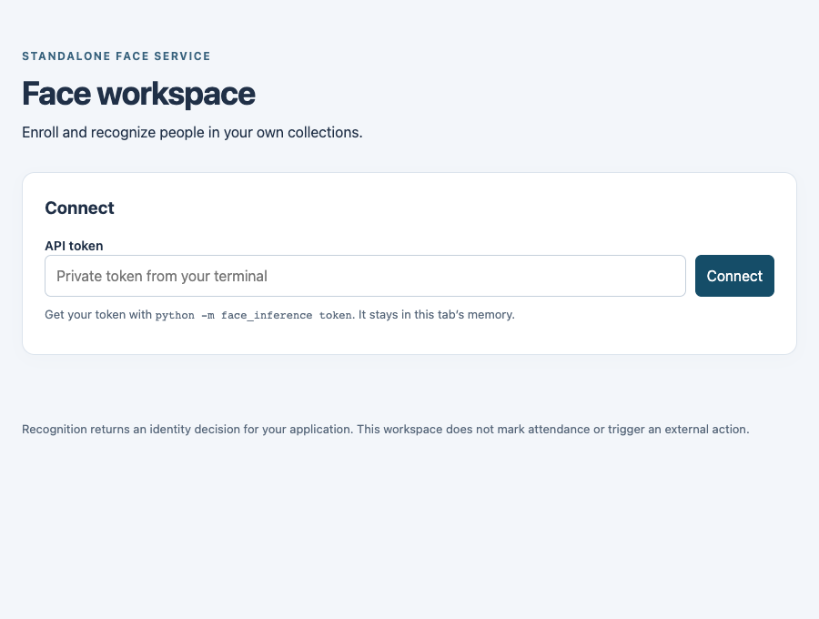
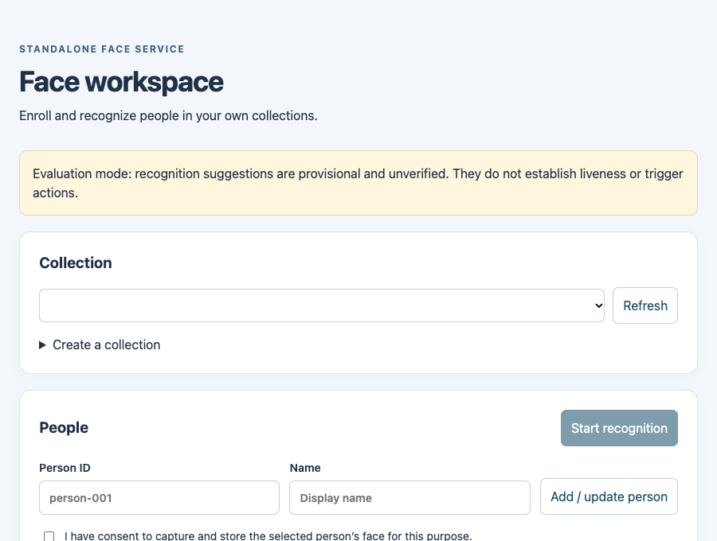
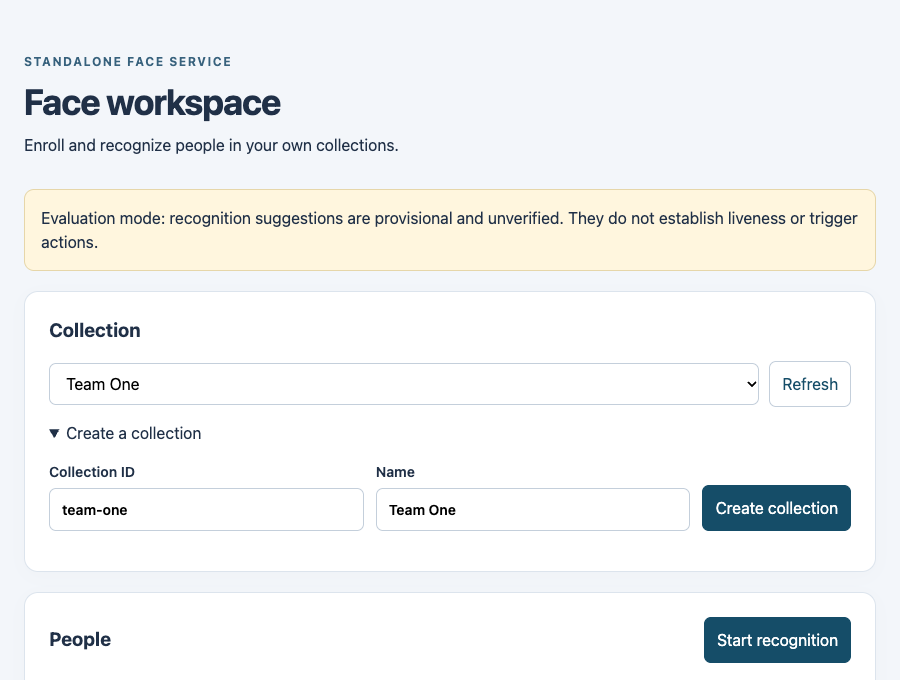
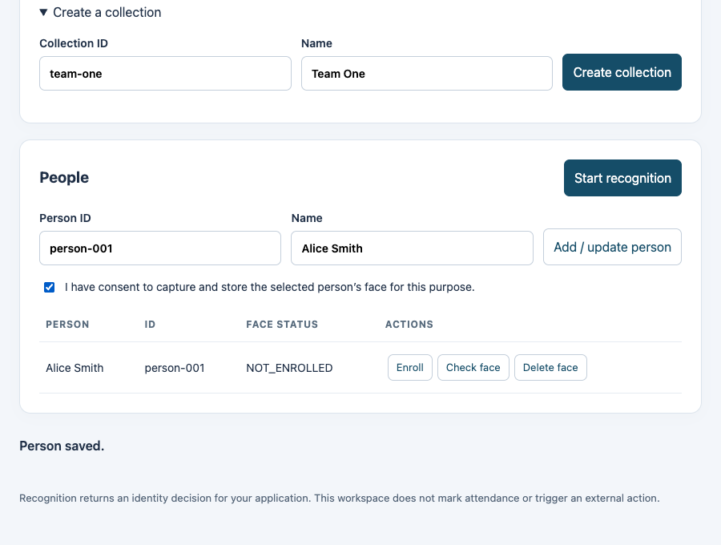
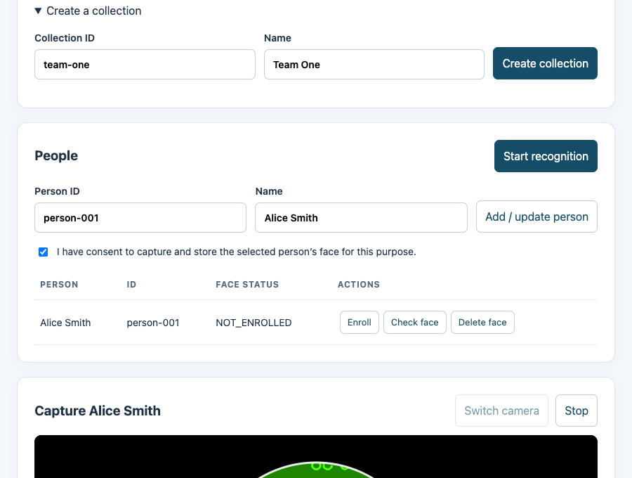
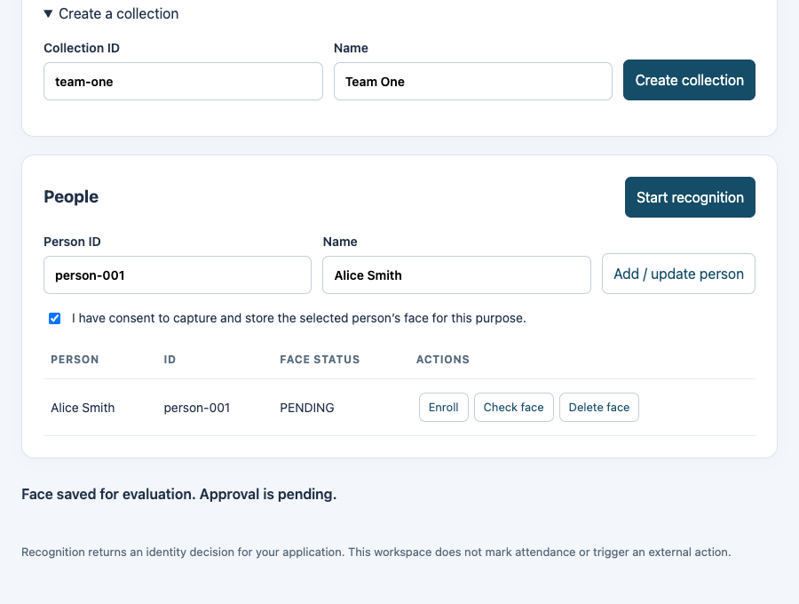

# Start Here: Beginner's Guide to face_inference

A complete, beginner-friendly walkthrough to install, run, enroll a face, recognize it, back up your data, and embed face recognition on your own web page in under 10 minutes.

---

## 0. What This Is and What You Need

`face_inference` is a fast, privacy-focused toolkit that lets you [enroll](glossary.md#enrollment) and [recognize](glossary.md#recognition) faces directly in your web browser. Face detection ([YuNet](glossary.md#yunet)) and feature extraction ([SFace](glossary.md#sface)) run entirely inside your browser using [WebAssembly](glossary.md#webassembly-wasm), so camera video and raw facial photographs never leave your computer. In the next 10 minutes, you will install the service, open the local dashboard, enroll a face with your webcam, and verify recognition.

### How to open a terminal
If you have never opened a terminal before:
- **macOS:** Press <kbd>Cmd</kbd> + <kbd>Space</kbd>, type `Terminal`, and press <kbd>Enter</kbd>.
- **Windows:** Press <kbd>Win</kbd> + <kbd>X</kbd> and select **Terminal** or search for `PowerShell` in your Start menu.
- **Linux:** Press <kbd>Ctrl</kbd> + <kbd>Alt</kbd> + <kbd>T</kbd> or open your application launcher and search for `Terminal`.

### What you need
- A computer (macOS, Linux, or Windows) with a working webcam.
- **Python 3.10 or newer**: Check by running:
  ```bash
  python3 --version
  ```
  *(Windows PowerShell: `python --version`)*  
  If the output is older than 3.10 or command is not found, install modern Python from https://www.python.org/downloads/.
- **Git**: Check by running:
  ```bash
  git --version
  ```
  If Git is missing, download it from https://git-scm.com/downloads.

> [!CAUTION]
> ### Before You Use This on Real People
> - **Always get consent:** You must inform people and obtain their unambiguous [consent](glossary.md#consent) before capturing, computing, or storing facial measurements.
> - **Biometric data is sensitive:** Facial templates are sensitive personal information subject to biometric privacy laws (such as GDPR, CCPA, and BIPA).
> - **Not a security lock:** This software is **NOT** a physical access control, door lock, or anti-spoofing system. It does **not** provide [liveness](glossary.md#liveness) detection and cannot distinguish a real human face from a printed photograph or phone screen replay.
> - **Review the privacy policy:** See [../PRIVACY.md](../PRIVACY.md) for details on encrypted storage, data retention, and permanent deletion.
> - *Notice: This document provides technical instructions and does not constitute legal advice.*

- **You should see:** Real version strings like `Python 3.12.x` and `git version 2.x.x` printed in your terminal (version numbers may differ).
- **If you do not see that:** see [docs/common-problems.md#python-too-old](common-problems.md#python-too-old) or [docs/common-problems.md#command-not-found-git](common-problems.md#command-not-found-git).

---

## 1. Download

Clone the repository to your computer and navigate into the project directory:

- **macOS / Linux:**
  ```bash
  git clone https://github.com/linkmeAman/face_inference.git
  cd face_inference
  ```

- **Windows PowerShell:**
  ```powershell
  git clone https://github.com/linkmeAman/face_inference.git
  cd face_inference
  ```

*(Windows commands follow the same steps; they are tested in automated checks but were not run by hand by the author.)*

- **You should see:**
  ```text
  Cloning into 'face_inference'...
  remote: Enumerating objects: ...
  Receiving objects: 100% ...
  done.
  ```
  *(Numbers and transfer stats may differ.)*
- **If you do not see that:** see [docs/common-problems.md#command-not-found-git](common-problems.md#command-not-found-git).

---

## 2. Install

> [!NOTE]
> **After the first release:** Once the package is officially published to PyPI, you will be able to install it using `pip install face-inference` or run it instantly with `uvx face-inference`. Until that release is published, installing from your local git clone is the primary path.
> 
> **Docker Alternative:** If you prefer running through [Docker](glossary.md#docker-image-and-container), run `docker compose up -d`. Labelled honestly: *Not yet verified on a live Docker by the maintainers*. See [docs/docker.md](docker.md).

Create an isolated [virtual environment](glossary.md#virtual-environment-venv) (`.venv`) and install the package:

- **macOS / Linux:**
  ```bash
  python3 -m venv .venv
  .venv/bin/python -m pip install .
  ```

- **Windows PowerShell:**
  ```powershell
  python -m venv .venv
  .\.venv\Scripts\python.exe -m pip install .
  ```

> [!TIP]
> Calling `.venv/bin/face-inference` directly executes using the virtual environment's dedicated Python binary and packages without requiring you to run `source` or change shell environment settings.

- **You should see:**
  ```text
  Successfully built face-inference
  Installing collected packages: tzdata, pycparser, cffi, cryptography, face-inference
  Successfully installed cffi-2.1.1 cryptography-50.0.2 face-inference-0.1.0 pycparser-3.12 tzdata-2026.6
  ```
  *(Version numbers and collected packages may differ.)*
- **If you do not see that:** see [docs/common-problems.md#pip-install-fails](common-problems.md#pip-install-fails).

---

## 3. First Start and the Access Token

An [API token](glossary.md#api-token) is a private 43-character cryptographic secret that authenticates all administrative operations, configuration changes, and web UI sessions.

Verify the pre-bundled model weights and print your private administrative token:

- **macOS / Linux:**
  ```bash
  .venv/bin/face-inference models verify
  .venv/bin/face-inference token
  ```

- **Windows PowerShell:**
  ```powershell
  .\.venv\Scripts\face-inference.exe models verify
  .\.venv\Scripts\face-inference.exe token
  ```

Where is it stored? The token and your master encryption key are stored in [config.json](glossary.md#configjson) inside your private [data directory](glossary.md#data-directory) (restricted to file mode `0600`). Never share your token or commit it to public version control; anyone who possesses it has full control over your stored face templates.

- **You should see:**
  ```json
  {
    "status": "PASS",
    "checked_assets": 6,
    "failures": []
  }
  ```
  Followed by a random 43-character token string:
  ```text
  gygnp-ez1I3b4wZkJdEoZI2s9sb55Fp7iUBx0hPf6zU
  ```
  *(Token characters will differ.)*
- **If you do not see that:** All model files are already pre-bundled in the downloaded repository. If files were accidentally deleted or corrupted, see the restoration steps in [docs/common-problems.md#models-missing-or-run-face-inference-models-fetch](common-problems.md#models-missing-or-run-face-inference-models-fetch).

---

## 4. Open the Page in Your Browser

Start the server process in your terminal:

- **macOS / Linux:**
  ```bash
  .venv/bin/face-inference serve
  ```

- **Windows PowerShell:**
  ```powershell
  .\.venv\Scripts\face-inference.exe serve
  ```

Now connect from your browser:
1. Open your web browser and navigate to: **http://127.0.0.1:6122** ([localhost](glossary.md#localhost-127001) on [port](glossary.md#port) 6122).
2. In the connection bar, paste the 43-character token you printed in Step 3 into the field labeled **API token** (placeholder *Private token from your terminal*).
3. Click the **Connect** button.



- **You should see:** Terminal output:
  ```text
  Face service: http://127.0.0.1:6122
  Use python -m face_inference token in your terminal to get the private API token.
  ```
  In your browser, the status message displays `Connected.`, an informational mode banner appears (`Evaluation mode: recognition suggestions are provisional and unverified. They do not establish liveness or trigger actions.`), and the workspace unhides with the Collection selector unlocked.



- **If you do not see that:** see [docs/common-problems.md#invalid-token-or-401](common-problems.md#invalid-token-or-401) or [docs/common-problems.md#page-will-not-load](common-problems.md#page-will-not-load).

---

## 5. Make a Collection and Add a Person

A [collection](glossary.md#collection) is a named folder or group of people (such as a team, department, or event roster) whose faces you want to organize and match together.

1. Click **Create a collection** to expand the creation panel.
2. Enter:
   - **Collection ID:** `team-one`
   - **Name:** `Team One`
3. Click the **Create collection** button.



4. Under the **People** section, add your first person:
   - **Person ID:** `person-001`
   - **Name:** `Alice Smith`
5. Click **Add / update person**.
6. Check the mandatory consent box:
   `[x] I have consent to capture and store the selected person’s face for this purpose.`  
   *What this means:* You verify that the person being enrolled was informed and explicitly granted [consent](glossary.md#consent) to have their biometric measurements recorded in this collection.



- **You should see:** `team-one` selected in the Collection dropdown, and a new row in the People table with name `Alice Smith`, ID `person-001`, Face status `NOT_ENROLLED`, and an enabled **Enroll** button.
- **If you do not see that:** see [docs/common-problems.md#database-is-locked](common-problems.md#database-is-locked).

---

## 6. Enroll

Click the **Enroll** button next to Alice Smith in the People table:

1. **What the camera does:** Your browser will display a permission prompt asking to access your camera. Click **Allow**. A video preview panel opens displaying your live webcam feed with a circular alignment guide and a progress bar.
2. **What to do with your face:** Look directly at the webcam, keep your face centered inside the circle, ensure your room is reasonably lit, and hold still for 2–3 seconds while frames are collected.
3. **What each message on screen means:**
   - `Starting camera`: Webcam hardware is powering on.
   - `Position face inside the circle.`: The model is scanning the frame for a single detected face.
   - `Capturing...`: Face detected with good quality and lighting; collecting biometric frames.
   - `Hold steady`: Slight motion blur detected; keep your head still.
   - `Move closer`: Face bounding box is too small in the camera view.
   - `Improve lighting and try again.`: Scene is underexposed or overexposed.
   - `Only one face at a time`: More than one person is visible in frame.
   - `Face saved for evaluation. Approval is pending.`: Successful enrollment in default evaluation mode! The biometric [template](glossary.md#template-embedding) is encrypted and saved.


*(Note: Your own webcam will display your live face here; this test capture uses a synthetic test pattern.)*

> [!NOTE]
> ### Why does it say "Approval is pending"?
> If you see `Face saved for evaluation. Approval is pending.`, do not worry: **this is completely normal and means enrollment succeeded!**  
> The service operates in [evaluation mode](glossary.md#evaluation-mode) by default. In evaluation mode, all newly enrolled facial templates are stored with state `PENDING`. Crucially, **face recognition already works immediately against PENDING faces** (`src/face_inference/service.py:203`). When you test recognition in Step 7, the system will match against this face and report an `Evaluation suggestion`. The state word `ACTIVE` and the message `Face enrolled.` appear only after an approved matching policy is formally loaded and activated.

### What the state words in the People table mean
The People table displays the exact biometric lifecycle status for each person:
- `NOT_ENROLLED`: The person was added to the collection, but no facial capture has been stored yet (or their previous face data was deleted).
- `PENDING`: The person's face was captured and saved in evaluation mode (the default mode). Facial templates are encrypted and recognition suggestions work immediately; formal activation to approved mode is pending.
- `ACTIVE`: The person's face template is formally activated and approved for production matching after policy validation.
- `REJECTED_DUPLICATE`: Enrollment was rejected because this face closely matches an already enrolled person in the collection (protects against duplicate identities).
- `RECAPTURE_REQUIRED`: Stored template has expired past the [retention period](glossary.md#retention-period) (default 30 days) or is incompatible with updated models, requiring a fresh camera scan.



- **You should see:** The camera panel closes and the table updates to display Face status `PENDING` next to Alice Smith with the confirmation message: `Face saved for evaluation. Approval is pending.`
- **If you do not see that:** see [docs/common-problems.md#camera-blocked-or-permission-denied](common-problems.md#camera-blocked-or-permission-denied) or [docs/common-problems.md#black-camera-screen](common-problems.md#black-camera-screen).

---

## 7. Recognize

Now test recognizing the enrolled face:

1. Click the **Start recognition** button at the top of the People panel.
2. Look at the camera.
3. **What the messages mean:**
   - `Ready to scan`: Camera is active and waiting for a subject to appear.
   - `Recognizing...`: A face is detected and its feature vector is being computed.
   - `Evaluation suggestion: Alice Smith (unverified)`: The system matched the face to Alice Smith in [evaluation mode](glossary.md#evaluation-mode).
   - `Matched: Alice Smith`: Confirmed match when operating in approved mode.
   - `Face not recognized. `: No enrolled face in the collection matched above the confidence threshold.

- **You should see:** The screen highlights the match with: `Evaluation suggestion: Alice Smith (unverified)` (or `Matched: Alice Smith` in approved mode).
- **If you do not see that:** see [docs/common-problems.md#camera-blocked-or-permission-denied](common-problems.md#camera-blocked-or-permission-denied).

---

## 8. Stop and Restart

1. **How to stop the service:** Switch to the terminal window where `face-inference serve` is running and press <kbd>Ctrl</kbd> + <kbd>C</kbd>.
2. **Restart:** Run `.venv/bin/face-inference serve` (PowerShell: `.\.venv\Scripts\face-inference.exe serve`).
3. **Where did the data go?** All collections, enrolled face templates, and configuration are persisted in SQLite on your disk. When you reload the page and connect, Alice Smith will still be listed as `PENDING` (or `ACTIVE`).

- **You should see:** The server terminates cleanly on <kbd>Ctrl</kbd> + <kbd>C</kbd> and restarts immediately without losing any enrolled faces.
- **If you do not see that:** see [docs/common-problems.md#port-already-in-use](common-problems.md#port-already-in-use).

---

## 9. Where Is My Data and How to Back It Up

By default, the server resolves your [data directory](glossary.md#data-directory) in this exact order (`src/face_inference/config.py:24-39`):
1. The folder specified by the `FACE_INFERENCE_HOME` environment variable (if set).
2. An existing `./.face-inference` folder in your current working directory (legacy fallback).
3. Your operating system's standard per-user data folder:
   - **macOS:** `~/Library/Application Support/face-inference`
   - **Linux:** `$XDG_DATA_HOME/face-inference` (or `~/.local/share/face-inference`)
   - **Windows:** `%APPDATA%\face-inference` (resolves inside your roaming application data folder `%APPDATA%`)

### Easiest way to find your exact data folder
Run the built-in check command in your terminal:

- **macOS / Linux:**
  ```bash
  .venv/bin/face-inference check
  ```

- **Windows PowerShell:**
  ```powershell
  .\.venv\Scripts\face-inference.exe check
  ```

- **You should see:**
  ```json
  {"status": "ready", "home": "<home-dir>/Library/Application Support/face-inference", "config": "<home-dir>/Library/Application Support/face-inference/config.json", "database": "<home-dir>/Library/Application Support/face-inference/faces.sqlite3", "mode": "EVALUATION", "model_version": "sface-int8bq-fb143eea"}
  ```
  *(Username paths, mode, and model version hashes may differ.)*  
  The `"home"` property shows your exact data folder.

### How to open that folder in your file manager
- **macOS:** Run `open "$HOME/Library/Application Support/face-inference"`
- **Linux:** Run `xdg-open "${XDG_DATA_HOME:-$HOME/.local/share}/face-inference"`
- **Windows PowerShell:** Run `explorer "$env:APPDATA\face-inference"`

Inside this directory are two critical files:
1. `faces.sqlite3`: The database containing encrypted biometric templates and audit logs.
2. `config.json`: Contains your API token and the master `encryption_key`.

### Creating a backup snapshot
Run the built-in backup command:

- **macOS / Linux:**
  ```bash
  .venv/bin/face-inference backup --output my-backup.sqlite3
  ```

- **Windows PowerShell:**
  ```powershell
  .\.venv\Scripts\face-inference.exe backup --output my-backup.sqlite3
  ```

Now copy `config.json` next to it. The `backup` command saves **only the database**, and the key that unlocks it lives in `config.json`:

- **macOS:**
  ```bash
  cp "$HOME/Library/Application Support/face-inference/config.json" my-backup-config.json
  chmod 600 my-backup-config.json
  ```
- **Linux:**
  ```bash
  cp "${XDG_DATA_HOME:-$HOME/.local/share}/face-inference/config.json" my-backup-config.json
  chmod 600 my-backup-config.json
  ```
- **Windows PowerShell:**
  ```powershell
  Copy-Item "$env:APPDATA\face-inference\config.json" my-backup-config.json
  ```

(If you set `FACE_INFERENCE_HOME` or use a `.face-inference` folder, copy `config.json` from the `"home"` folder that `face-inference check` printed.)

> [!CAUTION]
> **Lose config.json = lose all enrolled faces.**  
> Face templates in `faces.sqlite3` are strongly encrypted with the key in `config.json`. A database backup without its matching `config.json` is unreadable ciphertext and cannot be recovered. `config.json` also holds your admin token, so keep the pair together in a private, access-controlled place and never share it.

- **You should see:** Two files, `my-backup.sqlite3` and `my-backup-config.json`, both readable only by you.
- **If you do not see that:** see [docs/common-problems.md#lost-config-json](common-problems.md#lost-config-json).

---

## 10. Start Automatically or Run on Another Computer

- **Background service on Linux / macOS:** Set up systemd or launchd by following the production deployment guide in [docs/deployment.md](deployment.md).
- **Run in Docker:** Containerize the service and isolate data with Docker volumes by following [docs/docker.md](docker.md).

- **You should see:** Architectural guidance and unit service files in [docs/deployment.md](deployment.md).
- **If you do not see that:** see [docs/common-problems.md#page-will-not-load](common-problems.md#page-will-not-load).

---

## 11. Put It on Your Own Web Page in 5 Minutes (Optional)

> [!NOTE]
> **This step is OPTIONAL:** Everything before this step works completely without Node.js. If you want to embed face recognition into an external web application using the `<face-capture>` custom HTML element, you will need **Node.js 22+ and npm** for this step (check with `node --version`; download from https://nodejs.org/).

You can embed face recognition on any web page using the `<face-capture>` custom HTML element and a temporary [session token](glossary.md#session-token).

### Step-by-step embed walkthrough:

1. **Build the component bundle:**
   ```bash
   npm run build --prefix packages/face-capture
   ```

2. **Allow your web page's origin on the server:**
   Set `FACE_INFERENCE_ALLOWED_ORIGINS` to the address of your web server (e.g. `http://127.0.0.1:8000`), then start the service:
   - **macOS / Linux:**
     ```bash
     export FACE_INFERENCE_ALLOWED_ORIGINS="http://127.0.0.1:8000"
     .venv/bin/face-inference serve --port 6122
     ```
   - **Windows PowerShell:**
     ```powershell
     $env:FACE_INFERENCE_ALLOWED_ORIGINS = "http://127.0.0.1:8000"
     .\.venv\Scripts\face-inference.exe serve --port 6122
     ```
     *(Windows commands in this step are untested-by-hand by the author.)*

3. **Mint a short-lived session token:**
   In another terminal, retrieve your admin token and request a restricted 5-minute session token for `team-one`:
   - **macOS / Linux:**
     ```bash
     ADMIN_TOKEN=$(.venv/bin/face-inference token)
     printf 'Authorization: Bearer %s\n' "$ADMIN_TOKEN" | curl -s -X POST http://127.0.0.1:6122/api/v1/session-tokens \
       -H @- \
       -H "Content-Type: application/json" \
       -d '{"collection_id":"team-one","scope":"recognize","ttl":300}'
     ```
   - **Windows PowerShell:**
     ```powershell
     $adminToken = (.\.venv\Scripts\face-inference.exe token).Trim()
     $headers = @{ "Authorization" = "Bearer $adminToken"; "Content-Type" = "application/json" }
     $body = '{"collection_id":"team-one","scope":"recognize","ttl":300}'
     $response = Invoke-RestMethod -Uri "http://127.0.0.1:6122/api/v1/session-tokens" -Method Post -Headers $headers -Body $body
     $response.data.token
     ```
     *(Windows commands in this step are untested-by-hand by the author.)*

   Copy the `token` string returned in the `data` object.

4. **Create `embed.html`:**
   Paste this complete HTML file into a new file:

   ```html
   <!DOCTYPE html>
   <html lang="en">
   <head>
     <meta charset="utf-8">
     <title>Face Recognition Embed</title>
     <!-- Import the web component module -->
     <script type="module" src="face-capture/face-capture.js"></script>
     <style>
       body { font-family: sans-serif; display: flex; flex-direction: column; align-items: center; padding: 40px; }
       h1 { font-size: 20px; }
       #result-box { margin-top: 16px; font-weight: bold; }
     </style>
   </head>
   <body>
     <h1>Face Recognition Embed</h1>
     
     <!-- Embed the custom element with your session token -->
     <face-capture
       api-url="http://127.0.0.1:6122"
       token="PASTE_YOUR_SESSION_TOKEN_HERE"
       collection="team-one"
       mode="recognize">
     </face-capture>

     <div id="result-box">Waiting for face scan...</div>

     <script>
       const fc = document.querySelector('face-capture');
       const resultBox = document.getElementById('result-box');

       fc.addEventListener('face-result', (event) => {
         const result = event.detail;
         resultBox.textContent = result.state === 'MATCHED'
           ? 'Matched: ' + result.person_name
           : result.state === 'SUGGESTED'
             ? 'Suggestion: ' + result.person_name
             : 'Result: ' + result.state;
       });

       fc.addEventListener('face-error', (event) => {
         resultBox.textContent = 'Error: ' + event.detail.message;
       });
     </script>
   </body>
   </html>
   ```

5. **Serve and test the page:**
   Put the page in its own empty folder and serve only that folder, on your own computer only:
   ```bash
   mkdir embed-demo
   mv embed.html embed-demo/
   cp -R packages/face-capture/dist embed-demo/face-capture
   cd embed-demo
   python3 -m http.server 8000 --bind 127.0.0.1
   ```
   > [!WARNING]
   > Never run this server in your project folder or your data folder. It would publish every file there, which can include `config.json` (your encryption key and admin token). `--bind 127.0.0.1` keeps it reachable from this computer only.
   Open **http://127.0.0.1:8000/embed.html** in your browser.

- **You should see:** The `<face-capture>` element mounts with camera preview controls and communicates with your local service using the session token.
- **If you do not see that:** see [docs/common-problems.md#origin-rejected-403](common-problems.md#origin-rejected-403).

---

## 12. What Next

Explore detailed architectural specifications, configuration references, and security policies:
- **Configuration & Integration Guide:** [docs/guide.md](guide.md)
- **REST API OpenAPI Specification:** [docs/openapi.yaml](openapi.yaml)
- **Privacy Policy & Subject Rights:** [../PRIVACY.md](../PRIVACY.md)
- **Security Policy & Threat Model:** [../SECURITY.md](../SECURITY.md)
- **Production Deployment:** [docs/deployment.md](deployment.md)
- **Advanced Troubleshooting:** [docs/troubleshooting.md](troubleshooting.md)
- **Glossary of Terms:** [docs/glossary.md](glossary.md)

---

## Quick Reference Card

Keep this card handy or print it for daily use:

| Action | macOS / Linux | Windows PowerShell |
|---|---|---|
| **Start server** | `.venv/bin/face-inference serve` | `.\.venv\Scripts\face-inference.exe serve` |
| **Stop server** | Press <kbd>Ctrl</kbd> + <kbd>C</kbd> in server terminal | Press <kbd>Ctrl</kbd> + <kbd>C</kbd> in server terminal |
| **Print API token** | `.venv/bin/face-inference token` | `.\.venv\Scripts\face-inference.exe token` |
| **Backup database** | `.venv/bin/face-inference backup --output backup.sqlite3` | `.\.venv\Scripts\face-inference.exe backup --output backup.sqlite3` |
| **Where's my data?** | `.venv/bin/face-inference check` | `.\.venv\Scripts\face-inference.exe check` |
| **Troubleshooting** | See [docs/common-problems.md](common-problems.md) | See [docs/common-problems.md](common-problems.md) |
