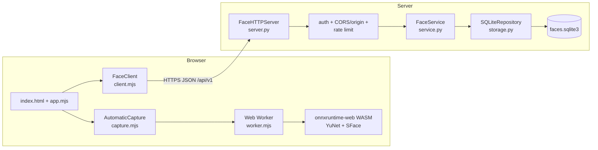
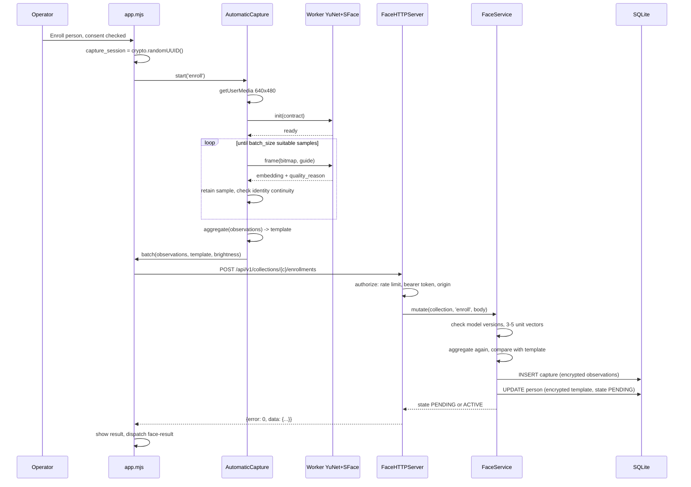
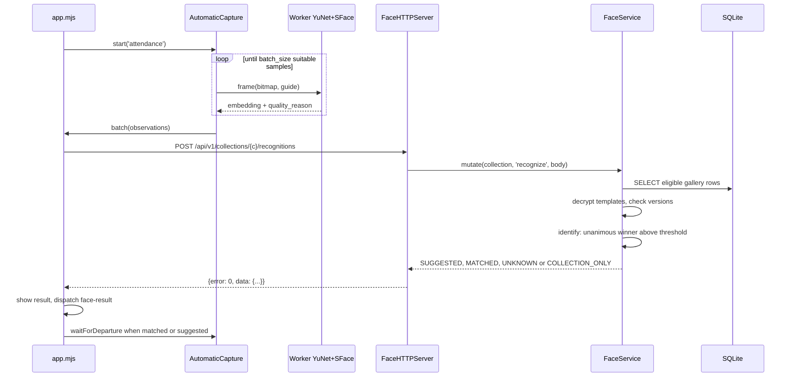
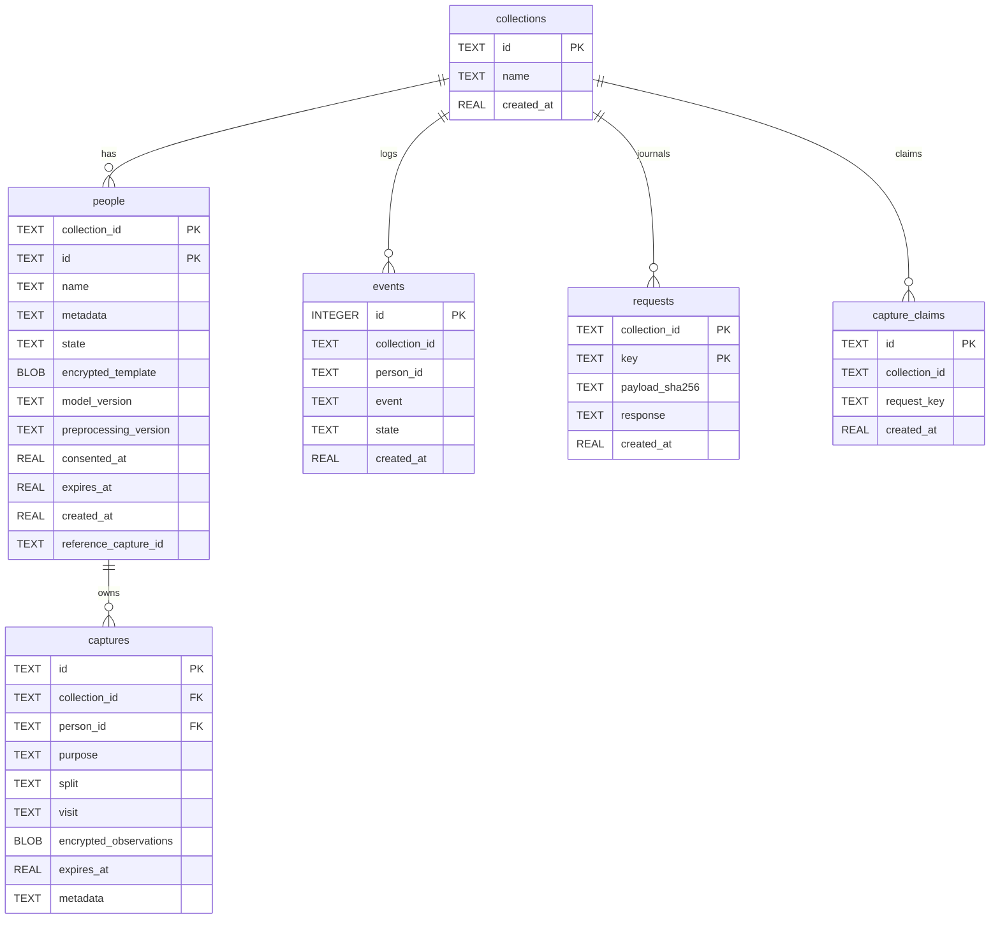

# Architecture

This is a small two-tier system. A browser page captures camera frames, runs YuNet
face detection and SFace embedding locally with onnxruntime-web (WASM), and sends
only the resulting 128-dimensional embeddings to a Python server. The server
authenticates and rate-limits the request, aggregates the observations into a
template, encrypts it with Fernet, and stores it in SQLite next to people, capture
evidence and an idempotency journal. Recognition runs on the server by comparing
the submitted embeddings with decrypted reference templates; the browser never
uploads an image, and the server never performs inference.

Source: `src/face_inference/server.py:1`, `src/face_inference/web/app.mjs:1-2`,
`src/face_inference/web/browser-face/worker.mjs:1-16`,
`src/face_inference/service.py:25-28`, `src/face_inference/storage.py:10-34`,
`docs/contract.md:3-6`.

## Components

The browser tier is the existing camera UI: `app.mjs` wires `AutomaticCapture` to
`FaceClient`. `AutomaticCapture` owns `getUserMedia`, the worker lifecycle and the
sample buffer; `worker.mjs` owns both ONNX sessions and the per-frame math in
`core.mjs`. The server tier is a standard-library `ThreadingHTTPServer` whose
`Handler` performs authorization and routing, `FaceService` performs all identity
decisions, and `SQLiteRepository` is the only code that touches SQLite or the
encryption key.

Source: `src/face_inference/web/app.mjs:1-2,44-72`,
`src/face_inference/web/browser-face/capture.mjs:4-8,88-112,214-238`,
`src/face_inference/web/browser-face/worker.mjs:1-16`,
`src/face_inference/web/browser-face/core.mjs:1`,
`src/face_inference/web/client.mjs:2-5`,
`src/face_inference/server.py:44-64,87-96,192-268`,
`src/face_inference/service.py:25-32`, `src/face_inference/storage.py:10-18`.

## Enrollment sequence

Step by step:

1. `app.mjs` refuses to start enrollment unless the consent checkbox is ticked,
   allocates one `capture_session` UUID for the whole capture, and starts
   `AutomaticCapture` in `enroll` mode (`src/face_inference/web/app.mjs:39-44,72`).
2. `AutomaticCapture.start` requires a secure context and `getUserMedia`, requests
   640x480, and creates the module worker with the model contract
   (`src/face_inference/web/browser-face/capture.mjs:8-37,88-112`). The worker
   loads YuNet and SFace from the served asset directory and sets
   `ort.env.wasm.wasmPaths` to it (`src/face_inference/web/browser-face/worker.mjs:4-16`).
3. Each tick draws the frame into an OffscreenCanvas, runs YuNet, selects a single
   face inside the guide, aligns it to 112x112, checks brightness/blur/clipping,
   runs SFace and returns a normalized 128-d embedding
   (`src/face_inference/web/browser-face/capture.mjs:214-238`,
   `src/face_inference/web/browser-face/worker.mjs:17-55`).
4. `AutomaticCapture` keeps only `SUITABLE` single-face samples, re-checks that a
   returning face matches the samples already held, and when the batch is full
   computes the medoid/MAD aggregate and calls the `batch` callback
   (`src/face_inference/web/browser-face/capture.mjs:279-310,335-343`,
   `src/face_inference/web/browser-face/core.mjs:16-28`).
5. The callback builds the enrollment body: `capture_session`, `observations`,
   `template`, `model_version`, `preprocessing_version`, `person_id`, `consent:true`,
   a hashed device label and a lighting label, then POSTs it through `FaceClient`
   (`src/face_inference/web/app.mjs:50-62`).
6. The server authorizes the request, then `FaceService.mutate` validates the
   payload shape, checks the model/preprocessing versions, requires 3-5 finite
   unit vectors, recomputes the aggregate and rejects a supplied template that
   does not match it (`src/face_inference/server.py:133-168,228-252`,
   `src/face_inference/service.py:83-99,128-136,155-159,183-190`).
7. The labeled observations are stored encrypted in `captures`; the reference
   template is stored encrypted in `people`; state becomes `PENDING` and, only
   with an approved policy, `activate` may promote it to `ACTIVE`
   (`src/face_inference/service.py:171-181,211-227`,
   `src/face_inference/storage.py:56-57`).

## Recognition sequence

Recognition reuses the same capture and batch machinery with a new
`capture_session` per request and no `person_id`/`consent`
(`src/face_inference/web/app.mjs:50-52,72,79`). The server builds the gallery from
people that have a non-expired encrypted template, consent and a compatible
model/preprocessing version, decrypting each template for scoring
(`src/face_inference/service.py:161-169`). `identify` requires every observation
to accept exactly one person above the threshold, otherwise it returns
`UNKNOWN` with a reason (`src/face_inference/matching.py:63-76`). In `EVALUATION`
mode a hit is reported as `SUGGESTED` with `verified:false`; only an approved
policy yields `MATCHED` (`src/face_inference/service.py:229-247`). Recognition
never updates the reference template and sets `business_action:false`
(`src/face_inference/service.py:244-247`, `docs/contract.md:49-58`).

## Data model

| Table | Holds | Sensitive values |
| --- | --- | --- |
| `metadata` | schema version and encrypted key-check | Fernet-encrypted check value |
| `collections` | collection id, name, creation time | none |
| `people` | person id/name, JSON metadata, lifecycle state, model versions, consent/expiry, reference capture id | `encrypted_template` (Fernet) |
| `captures` | one labeled observation batch: purpose, split, visit date, expiry, evidence JSON | `encrypted_observations` (Fernet) |
| `requests` | idempotency journal: request key, payload SHA-256, committed response | response JSON is plaintext |
| `capture_claims` | one row per submitted capture UUID | none |
| `events` | last-100 audit summaries: event, resulting state, time | none |

Both biometric columns are BLOBs written through `SQLiteRepository.encrypt`,
which serializes JSON and applies authenticated Fernet encryption; reads go
through `decrypt` (`src/face_inference/storage.py:56-63`). The encryption key is
bound to the database by a stored key check, so reopening with a different key
fails instead of silently returning garbage (`src/face_inference/storage.py:22-34`).
Evidence metadata, names, request journals and audit events are not encrypted,
and the database file is created with mode `0600` in a `0700` directory
(`src/face_inference/storage.py:14,34`).

Source: `src/face_inference/schema.sql:1-29`,
`src/face_inference/service.py:201-224`, `src/face_inference/storage.py:10-63`,
`docs/contract.md:38-47`.

## Trust boundaries and what runs where

- **Browser (untrusted client).** Camera access, YuNet/SFace inference, sample
  selection, aggregation and the UI all run here
  (`src/face_inference/web/browser-face/capture.mjs:232-236`,
  `src/face_inference/web/browser-face/worker.mjs:17-55`). The API token is kept
  in memory by the page and sent as a bearer header; it is not written to
  localStorage or cookies (`src/face_inference/web/app.mjs:75`,
  `src/face_inference/web/client.mjs:3-12`, `docs/guide.md:54-55`).
- **No image leaves the browser.** The only payload is the observation/template
  JSON built in `app.mjs`; the bitmap is transferred to the local worker and
  closed (`src/face_inference/web/app.mjs:50-58`,
  `src/face_inference/web/browser-face/capture.mjs:230-236`). The server has no
  upload route; its API accepts JSON only (`src/face_inference/server.py:170-190,228-256`).
- **Server (trusted).** The server treats embeddings as untrusted input: it
  requires 3-5 finite 128-d unit vectors, re-aggregates them, and compares the
  client template against its own result (`src/face_inference/matching.py:12-60`,
  `src/face_inference/service.py:155-159,183-190`). Thresholds and mode come from
  server config, never from the request (`src/face_inference/service.py:106-108`,
  `src/face_inference/config.py:193-226`).
- **Request gate.** Rate limit by client IP, bearer token or scoped session token,
  exact-origin check for browser calls, 128 KiB JSON body limit, duplicate-key and
  non-finite-number rejection, and an 8-connection semaphore with `503` overflow
  (`src/face_inference/server.py:20,44-84,133-190`).
- **Storage boundary.** Only `SQLiteRepository` opens the database and holds the
  Fernet cipher; the service receives a transaction connection and never sees the
  key (`src/face_inference/storage.py:10-18,43-54`,
  `src/face_inference/service.py:100-101`). Writes run under `BEGIN IMMEDIATE`
  with foreign keys, WAL and a 10-second busy timeout
  (`src/face_inference/storage.py:36-54`).

## Configuration and data locations

The data directory (`home`) resolves in this order: `FACE_INFERENCE_HOME`, an
existing `./.face-inference/` (with a one-line notice), then the per-user OS data
directory (`~/Library/Application Support/face-inference` on macOS,
`$XDG_DATA_HOME/face-inference` or `~/.local/share/face-inference` on Linux,
`%APPDATA%\face-inference` on Windows)
(`src/face_inference/config.py:22-36`). `home` contains `config.json` (mode
`0600`), `faces.sqlite3`, and, when used, a `models/` directory
(`src/face_inference/config.py:44-59`, `src/face_inference/storage.py:14,34`).

`config.json` is generated on first run with: loopback host `127.0.0.1`, port
`6122`, absolute database path, generated `api_token`, `encryption_key` and
`session_secret`, `mode: EVALUATION`, duplicate/recognition thresholds `0.85`/`0.65`,
`retention_days: 30`, `max_people: 1000`, `allowed_origins: []`,
`rate_limit_per_minute: 120` and `trusted_proxies: []`
(`src/face_inference/config.py:50-56`). Listener, origin, rate-limit and proxy
settings can be overridden per run by `FACE_INFERENCE_HOST`, `FACE_INFERENCE_PORT`,
`FACE_INFERENCE_ALLOWED_ORIGINS`, `FACE_INFERENCE_RATE_LIMIT` and
`FACE_INFERENCE_TRUSTED_PROXIES`; overrides are not saved
(`src/face_inference/config.py:83-113`, `docs/guide.md:70-79`).

Model/runtime assets resolve to `FACE_INFERENCE_MODELS_DIR`, else
`<home>/models` when it verifies, else the packaged
`src/face_inference/web/vendor/browser-face`, else `<home>/models` as the
fetch destination (`src/face_inference/assets.py:68-91`). Verification checks every
file in `manifest.json` by size and SHA-256 and rejects symlinks
(`src/face_inference/assets.py:45-65,94-111`). The server serves only the top-level
web files plus `/browser-face/*` and `/vendor/browser-face/*`, with explicit MIME
types including `application/wasm`, and refuses symlinks
(`src/face_inference/server.py:52-63,257-267`).

Source: `src/face_inference/config.py:22-36,44-59,83-113`,
`src/face_inference/assets.py:68-91`, `src/face_inference/server.py:52-63,257-267`,
`docs/guide.md:38-79`.

## What this is not

- **Not a liveness or presentation-attack detector.** Quality checks reject small,
  dark, blurred or clipped faces, and the enrollment continuity check rejects a
  different returning face, but none of that proves a live person is present.
  The service reports `liveness_validated:false` and recognition does not
  establish liveness (`src/face_inference/service.py:34-38`,
  `src/face_inference/web/browser-face/capture.mjs:279-302`, `README.md:65`).
- **Not an identity authority by default.** Default mode is `EVALUATION`:
  enrollment is `PENDING`, recognition returns `SUGGESTED` with `verified:false`,
  and no business action is triggered. `MATCHED` requires an approved,
  hash-verified policy and report (`src/face_inference/service.py:229-247`,
  `src/face_inference/config.py:193-226`, `docs/contract.md:49-58`).
- **Not a multi-tenant authorization system.** The API token grants access to all
  collections; `eligible_ids` only narrows a recognition inside one collection
  (`docs/contract.md:33-36`, `src/face_inference/service.py:234-241`).
- **Not an image store.** Raw camera frames are never uploaded or persisted; only
  embeddings and capture evidence metadata are stored
  (`docs/contract.md:61`, `src/face_inference/web/app.mjs:50-58`).

Source: `src/face_inference/service.py:34-38,229-247`,
`src/face_inference/config.py:193-226`, `docs/contract.md:33-36,49-61`,
`README.md:63-65`.
